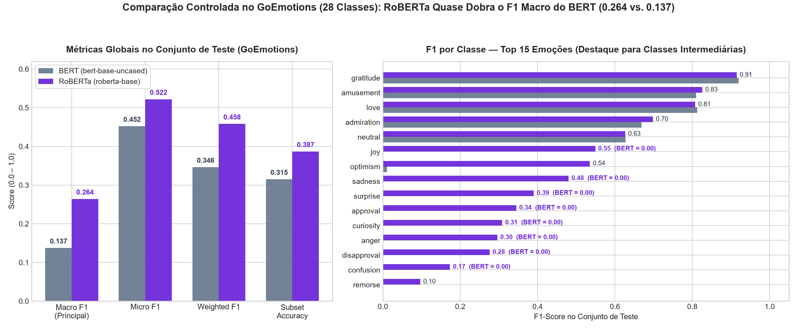
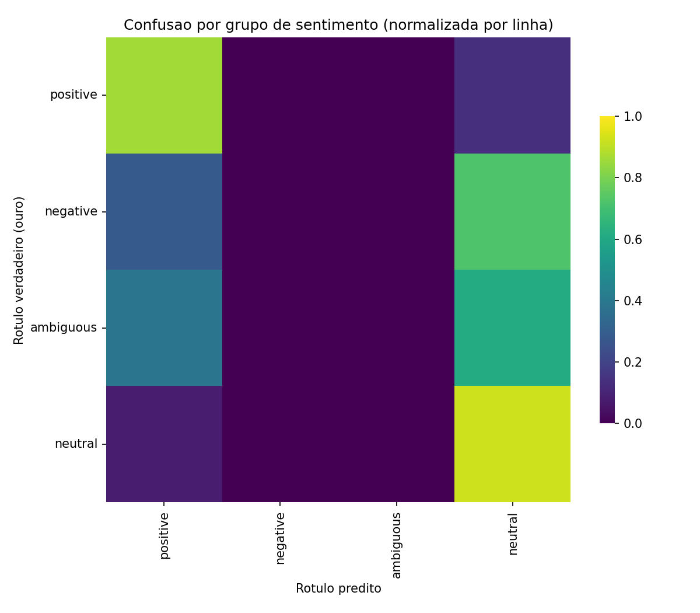
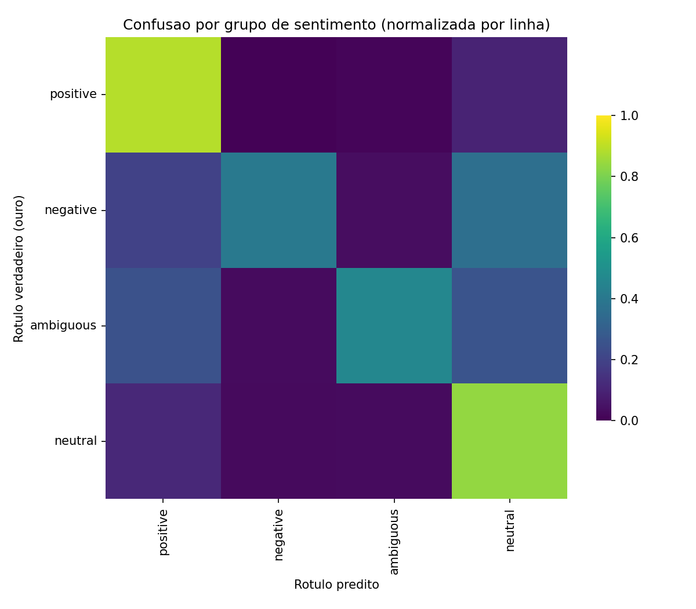
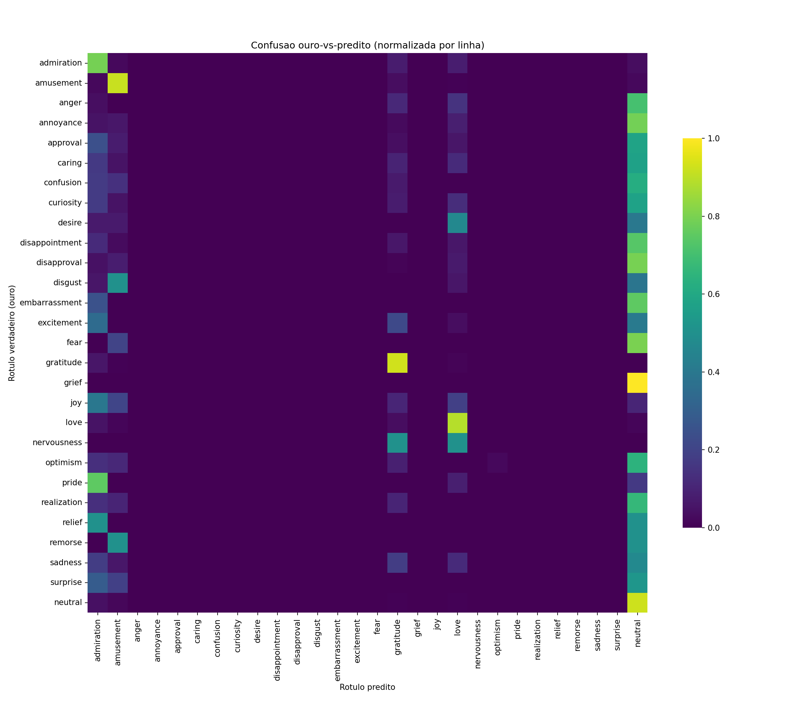
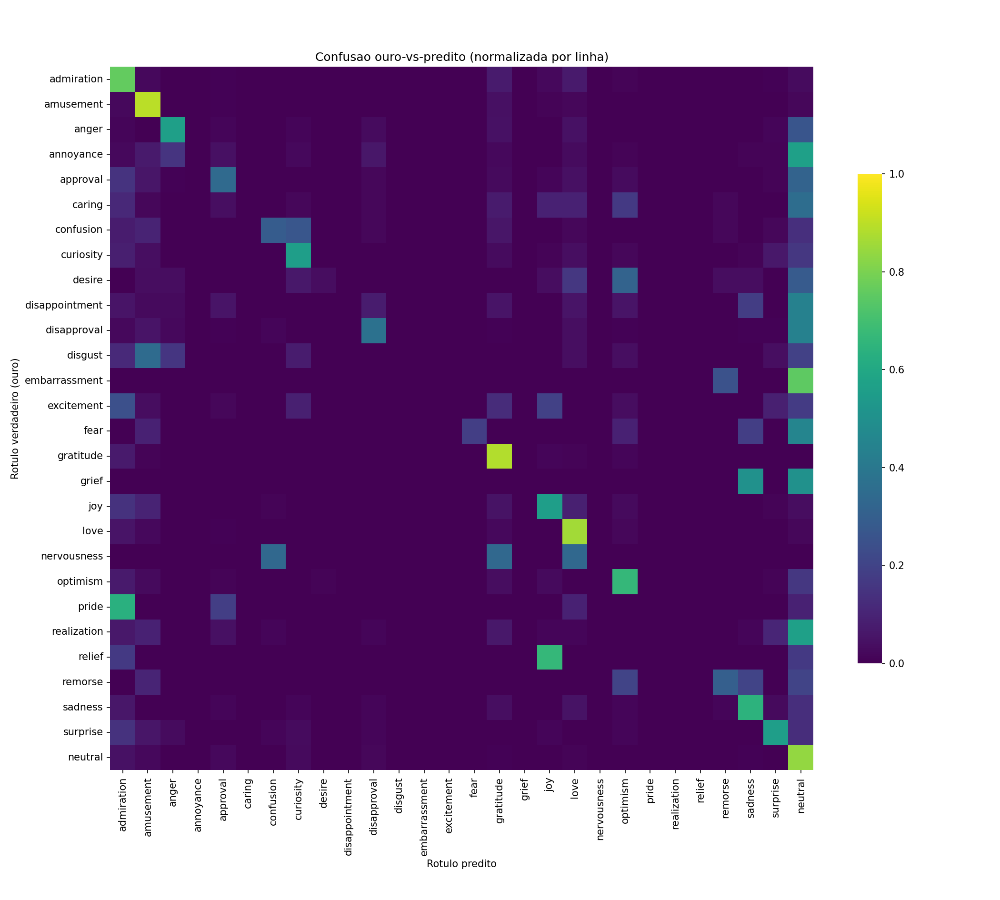
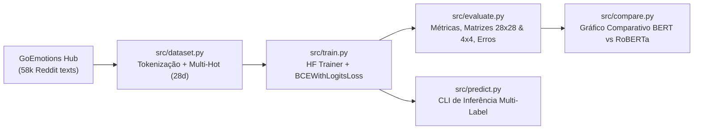

# Classificação Multirrótulo de Emoções de Granularidade Fina com Transformers (BERT vs. RoBERTa no GoEmotions)

[](.github/workflows/ci.yml)
[](https://www.python.org/)
[](https://pytorch.org/)
[](https://huggingface.co/docs/transformers)
[-6D28D9)](https://huggingface.co/datasets/google-research-datasets/go_emotions)
[](LICENSE)

> **🇬🇧 Executive Summary (English):**
> This repository presents a controlled empirical study and production-structured NLP pipeline for **fine-grained multi-label emotion classification** on the **GoEmotions** corpus (~58,000 Reddit comments annotated across **28 classes**: 27 emotions + `neutral`). Since a single comment can express multiple emotions simultaneously (~16% of the dataset), the problem is framed via independent per-class sigmoid outputs trained with Binary Cross-Entropy (`BCEWithLogitsLoss`).
>
> Under strictly identical hyperparameters, classification heads, and evaluation protocols, we compare **BERT (`bert-base-uncased`)** — the baseline used in the original Google Research paper — against **RoBERTa (`roberta-base`)**:
> - **RoBERTa nearly doubles BERT's Macro F1 on the test set (`26.41%` vs. `13.75%`, a `+92.1%` relative gain)** and consistently outperforms BERT across Micro F1 (`52.19%` vs. `45.21%`), Weighted F1 (`45.82%` vs. `34.63%`), and exact-match Subset Accuracy (`38.68%` vs. `31.51%`).
> - **Class Coverage Expansion (`6/28` → `17/28`):** While BERT collapses into predicting only the 5 most frequent head classes (`gratitude`, `love`, `amusement`, `admiration`, `neutral`) and completely ignores negative and ambiguous sentiment groups, RoBERTa unlocks 11 intermediate-frequency emotions (including `joy`, `optimism`, `sadness`, `surprise`, `approval`, `curiosity`, `anger`, `disapproval`, and `confusion`), recovering the `negative` (`40.4%` recall) and `ambiguous` (`46.3%` recall) sentiment diagonals.
> - **Key Bottleneck Identified:** Error analysis reveals that remaining failures in RoBERTa stem primarily from **missed detections under a fixed `0.5` decision threshold** on the long tail of rare classes (`grief`, `relief`, `pride`) and fine-grained confusions between semantically adjacent emotions (`pride → admiration`, `relief → joy`), rather than polarity inversions.

---

## Sumário

1. [Motivação e Definição do Problema](#1-motivação-e-definição-do-problema)
2. [Principais Resultados Experimentais](#2-principais-resultados-experimentais)
3. [Análise de Erros (Por Classe, Sentimento e Qualitativa)](#3-análise-de-erros-por-classe-sentimento-e-qualitativa)
4. [Arquitetura do Projeto e Pipeline](#4-arquitetura-do-projeto-e-pipeline)
5. [Como Executar (Instalação, Treino, Avaliação e Inferência CLI)](#5-como-executar-instalação-treino-avaliação-e-inferência-cli)
6. [Testes Automatizados e Qualidade de Código](#6-testes-automatizados-e-qualidade-de-código)
7. [Documentação Acadêmica e Citação](#7-documentação-acadêmica-e-citação)

---

## 1. Motivação e Definição do Problema

A análise de sentimentos tradicional reduz a linguagem humana a três categorias de polaridade (`positivo`, `negativo`, `neutro`). Em aplicações reais — como assistentes conversacionais, moderação de comunidades, análise de feedback de produto e saúde mental — distinguir entre *gratidão*, *alívio*, *decepção*, *raiva* ou *curiosidade* é essencial para compreender a real intenção de quem escreve.

O corpus **GoEmotions** ([Demszky et al., ACL 2020](https://aclanthology.org/2020.acl-main.372/)) estabelece um benchmark desafiador para essa tarefa:
- **~58 mil comentários reais do Reddit** (divisão oficial `simplified`: `43.410` treino / `5.426` validação / `5.427` teste).
- **28 categorias:** 27 emoções de granularidade fina + `neutral`, agrupadas também em **4 macrogrupos de sentimento** (`positive`, `negative`, `ambiguous` e `neutral`).
- **Natureza Multirrótulo (*Multi-Label*):** Um comentário como *"Thank you so much, this really helped!"* expressa simultaneamente `gratitude` e `admiration`. Por isso, em vez de competição via *softmax*, modelamos 28 classificadores binários independentes ativados por **sigmoide** ($\sigma(z_c) \ge 0{,}5$) e otimizados com **`BCEWithLogitsLoss`**.
- **Desbalanceamento Severo (Cauda Longa):** Enquanto `neutral` (1.787 exemplos no teste) e `admiration` (504) são abundantes, classes como `grief` (6), `relief` (11) e `pride` (16) possuem pouquíssimas amostras.

---

## 2. Principais Resultados Experimentais



### 2.1. Métricas Agregadas no Conjunto de Teste

Para isolar o impacto do pré-treinamento e da tokenização (WordPiece no BERT vs. Byte-Level BPE e pré-treino estendido sem NSP no RoBERTa), ambos os modelos foram ajustados sob **hiperparâmetros estritamente idênticos** (`lr = 2e-5`, `batch_size = 64`, `max_length = 64`, `weight_decay = 0.01`, `warmup_ratio = 0.1`, `fp16 = True`, `seed = 42`, seleção do melhor checkpoint pelo **Macro F1** na validação):

| Métrica | Papel na Avaliação | BERT (`bert-base-uncased`) | RoBERTa (`roberta-base`) | Ganho Absoluto / Relativo |
| :--- | :--- | :---: | :---: | :---: |
| **Macro F1** *(Principal)* | Média simples entre as 28 classes; penaliza severamente o colapso nas classes raras | `0.1375` | **`0.2641`** | **+12,66 p.p. (+92,1%)** |
| **Micro F1** | Agrega TP/FP/FN globais; métrica de referência do artigo original | `0.4521` | **`0.5219`** | **+6,98 p.p. (+15,4%)** |
| **Weighted F1** | Média ponderada pelo suporte de cada classe no teste | `0.3463` | **`0.4582`** | **+11,19 p.p. (+32,3%)** |
| **Subset Accuracy** | *Exact match* estrito (fração de exemplos com **todos** os rótulos idênticos ao ouro) | `0.3151` | **`0.3868`** | **+7,17 p.p. (+22,8%)** |

> **Estabilidade de Generalização:** Ambos os modelos atingiram seu ótimo na 3ª época, com métricas de validação (`0.1346` no BERT e `0.2615` no RoBERTa) muito próximas às de teste, demonstrando ausência de *overfitting*.

---

## 3. Análise de Erros (Por Classe, Sentimento e Qualitativa)

### 3.1. Desempenho por Classe: Onde o RoBERTa Faz a Diferença?

A inspeção de [`results/bert/per_class_f1.csv`](results/bert/per_class_f1.csv) e [`results/roberta/per_class_f1.csv`](results/roberta/per_class_f1.csv) revela que as métricas globais escondem três regimes distintos de aprendizado:

| Regime da Taxonomia | Emoção | Grupo de Sentimento | Suporte (Teste) | F1 BERT | F1 RoBERTa | Diagnóstico |
| :--- | :--- | :---: | :---: | :---: | :---: | :--- |
| **1. Classes de Cabeça (*Head*)** | `gratitude` | Positive | 352 | **0.919** | 0.915 | Desempenho excelente e equivalente nos dois modelos |
| | `amusement` | Positive | 264 | 0.810 | **0.826** | Marcadores lexicais claros (*"lol"*, *"haha"*, agradecimentos) |
| | `love` | Positive | 238 | **0.813** | 0.808 | Alta precisão e recall em ambos |
| | `admiration` | Positive | 504 | 0.669 | **0.698** | RoBERTa ganha +2,9 p.p. |
| | `neutral` | Neutral | 1787 | **0.627** | **0.627** | Classe majoritária do corpus |
| **2. Frequência Intermediária** | `joy` | Positive | 161 | `0.000` | **`0.549`** | **Destravada pelo RoBERTa** (BERT colapsa em 0) |
| *(Destravadas pelo RoBERTa)* | `optimism` | Positive | 186 | `0.011` | **`0.535`** | **+52,4 p.p.** de ganho no RoBERTa |
| | `sadness` | Negative | 156 | `0.000` | **`0.480`** | **Destravada pelo RoBERTa** |
| | `surprise` | Ambiguous | 141 | `0.000` | **`0.390`** | **Destravada pelo RoBERTa** |
| | `approval` | Positive | 351 | `0.000` | **`0.345`** | **Destravada pelo RoBERTa** |
| | `curiosity` | Ambiguous | 284 | `0.000` | **`0.308`** | **Destravada pelo RoBERTa** |
| | `anger` | Negative | 198 | `0.000` | **`0.296`** | **Destravada pelo RoBERTa** |
| | `disapproval` | Negative | 267 | `0.000` | **`0.276`** | **Destravada pelo RoBERTa** |
| | `confusion` | Ambiguous | 153 | `0.000` | **`0.173`** | **Destravada pelo RoBERTa** |
| | `remorse` / `fear` / `desire` | Neg / Pos | 56 / 78 / 83 | `0.000` | `0.097` / `0.050` / `0.023` | Início de sensibilidade na transição para a cauda |
| **3. Cauda Longa (*Tail*)** | `grief`, `relief`, `pride`, `nervousness`, `embarrassment` | Neg / Pos | 6 a 37 | `0.000` | `0.000` | Limiar fixo `0.5` impede ativação sob escassez extrema |

### 3.2. Matrizes de Confusão por Grupo de Sentimento (`4×4`) e por Classe (`28×28`)

Ao agregar as predições nos 4 grupos propostos por Demszky et al. (2020), fica evidente o **colapso estrutural do BERT**: suas colunas `negative` e `ambiguous` são **integralmente nulas (`0.0%`)**, reduzindo todo o espectro emocional a um eixo `positive–neutral`. O **RoBERTa** recupera a diagonal dos quatro grupos:

| BERT — Confusão por Sentimento | RoBERTa — Confusão por Sentimento |
| :---: | :---: |
|  |  |

| BERT — Matriz 28×28 (Co-ativação Ouro vs. Predito) | RoBERTa — Matriz 28×28 (Co-ativação Ouro vs. Predito) |
| :---: | :---: |
|  |  |

### 3.3. Análise Qualitativa dos Modos de Falha

A análise das amostras exportadas em [`results/roberta/error_examples.csv`](results/roberta/error_examples.csv) mostra que os erros remanescentes do RoBERTa não são inversões grosseiras de polaridade, mas dividem-se em dois padrões principais:

1. **Detecção Perdida (*Missed Detection* sob limiar fixo de `0.5`):** Em classes raras ou comentários curtos/implícitos, nenhuma probabilidade ultrapassa `0.5`, gerando predição vazia `(nenhum)`.
2. **Confusão entre Vizinhas Semânticas:** O modelo ativa uma emoção do mesmo grupo afetivo com fronteira tênue até para anotadores humanos (ex.: `pride → admiration` em `64%` dos casos, `relief → joy` em `67%`, `confusion → curiosity` em `27%`).

| Comentário Real (Split de Teste do Reddit) | Rótulo Ouro (*Gold*) | Predição RoBERTa | Padrão de Erro Identificado |
| :--- | :--- | :--- | :--- |
| *"Kings fan here, good luck to you guys!"* | `excitement` | `optimism` | Confusão entre emoções positivas adjacentes |
| *"100%! Congrats on your job too!"* | `gratitude` | `admiration` | Confusão entre emoções positivas adjacentes |
| *"thats amazing!! Congrats!"* | `admiration`, `joy` | `admiration` | Acerto parcial multirrótulo (`joy` ficou abaixo de 0.5) |
| *"I'm sorry to hear that friend :("* | `remorse` | `(nenhum)` | Detecção perdida em classe minoritária (suporte = 56) |
| *"That was an incredibly dumb thing to do."* | `annoyance`, `disapproval`, `disgust` | `(nenhum)` | Detecção perdida sob múltiplas classes negativas difusas |

---

## 4. Arquitetura do Projeto e Pipeline



### Estrutura de Diretórios

```text
goemotions-multilabel-nlp/
├── .github/workflows/
│   └── ci.yml                      # Pipeline CI (Ruff Linter + Pytest em CPU)
├── configs/
│   ├── bert.yaml                   # Hiperparâmetros do baseline (bert-base-uncased)
│   └── roberta.yaml                # Hiperparâmetros do modelo principal (roberta-base)
├── docs/
│   ├── article.pdf                 # Artigo científico completo (formato SBC / UFRGS)
│   └── presentation.pdf            # Slides da apresentação final (PPGC/UFRGS)
├── notebooks/
│   └── colab_train.ipynb           # Notebook para treino acelerado em GPU (Google Colab)
├── results/
│   ├── comparison_bert_roberta.png # Painel visual comparativo (Métricas + Top 15 classes)
│   ├── bert/                       # Métricas (.json), relatórios (.csv) e matrizes (.png)
│   └── roberta/                    # Métricas (.json), relatórios (.csv) e matrizes (.png)
├── src/
│   ├── __init__.py
│   ├── labels.py                   # Taxonomia das 28 classes e 4 grupos de sentimento
│   ├── dataset.py                  # Loader do GoEmotions, encode_multihot e Collator dinâmico
│   ├── metrics.py                  # Sigmoid estável, Macro/Micro/Weighted F1 e Subset Accuracy
│   ├── train.py                    # Pipeline de fine-tuning com HuggingFace Trainer
│   ├── evaluate.py                 # Avaliação detalhada, heatmaps e amostragem de erros
│   ├── compare.py                  # Geração automatizada do gráfico comparativo
│   └── predict.py                  # API e CLI de inferência para novos textos
├── tests/                          # Testes unitários rápidos (pytest)
├── pyproject.toml                  # Empacotamento moderno, scripts CLI e config Ruff/Pytest
└── requirements.txt                # Dependências fixadas para reprodutibilidade
```

---

## 5. Como Executar (Instalação, Treino, Avaliação e Inferência CLI)

### 5.1. Instalação do Ambiente

```powershell
# 1. Criar e ativar ambiente virtual
python -m venv .venv
.\.venv\Scripts\Activate.ps1

# 2. (Opcional para GPU NVIDIA com CUDA 12.1) Instalar PyTorch compilado com CUDA
pip install torch==2.5.1 --index-url https://download.pytorch.org/whl/cu121

# 3. Instalar o pacote em modo editável + ferramentas de desenvolvimento (pytest, ruff)
pip install -e ".[dev]"
```

### 5.2. Treinamento (`src.train`)

Validação rápida do pipeline (*smoke test* com 200 amostras de treino e 1 época):

```powershell
python -m src.train --config configs/roberta.yaml --smoke
```

Treinamento completo (reprodução dos experimentos):

```powershell
python -m src.train --config configs/bert.yaml
python -m src.train --config configs/roberta.yaml
```

### 5.3. Avaliação Detalhada e Geração de Gráficos (`src.evaluate` e `src.compare`)

```powershell
# Gera classification_report.csv, per_class_f1.csv, matrizes de confusão e error_examples.csv
python -m src.evaluate --model_dir results/bert/best_model --output_dir results/bert
python -m src.evaluate --model_dir results/roberta/best_model --output_dir results/roberta

# Atualiza o painel comparativo results/comparison_bert_roberta.png
python -m src.compare
```

### 5.4. Inferência em Textos Customizados via CLI (`src.predict`)

Após treinar um checkpoint (ou passando um modelo compatível do Hugging Face Hub), classifique frases diretamente pelo terminal:

```powershell
python -m src.predict `
  --model_dir results/roberta/best_model `
  --text "Thank you so much, this really helped!" "Wait... what does that even mean?" `
  --threshold 0.5
```

Exemplo de saída formatada:

```text
========================================================================
  GoEmotions Multi-Label Inference  (threshold = 0.50)
========================================================================

[1] Text: "Thank you so much, this really helped!"
    Predicted Emotions : gratitude (94.2% | positive), admiration (61.8% | positive)
    Sentiment Group(s) : positive
    Top Probabilities  : gratitude: 94.2%, admiration: 61.8%, approval: 18.4%, joy: 9.1%, neutral: 3.2%

[2] Text: "Wait... what does that even mean?"
    Predicted Emotions : confusion (68.5% | ambiguous), curiosity (54.1% | ambiguous)
    Sentiment Group(s) : ambiguous
    Top Probabilities  : confusion: 68.5%, curiosity: 54.1%, neutral: 21.0%, surprise: 11.3%, annoyance: 6.4%

========================================================================
```

---

## 6. Testes Automatizados e Qualidade de Código

O projeto conta com suíte de testes unitários em [`tests/`](tests/) cobrindo a integridade da taxonomia de 28 classes, estabilidade numérica da sigmoide e métricas multirrótulo, codificação *multi-hot*, decodificação de inferência e geração gráfica, além de integração contínua via GitHub Actions:

```powershell
# Executar todos os testes unitários
pytest -v

# Verificar formatação e linting com Ruff
ruff check src tests
```

---

## 7. Documentação Acadêmica e Citação

- 📄 **Artigo Completo (PDF):** [`docs/article.pdf`](docs/article.pdf) — *Classificação de Emoções de Granularidade Fina com Transformers: BERT e RoBERTa no Corpus GoEmotions* (Instituto de Informática — PPGC/UFRGS).
- 📊 **Apresentação de Slides (PDF):** [`docs/presentation.pdf`](docs/presentation.pdf).

```bibtex
@techreport{piccoli2026goemotions,
  author      = {Gustavo Auad Piccoli},
  title       = {Classifica{\c{c}}{\~a}o de Emo{\c{c}}{\~o}es de Granularidade Fina com Transformers: {BERT} e {RoBERTa} no Corpus {GoEmotions}},
  institution = {Instituto de Inform{\'a}tica -- Universidade Federal do Rio Grande do Sul (UFRGS)},
  year        = {2026},
  address     = {Porto Alegre, RS, Brasil}
}
```
